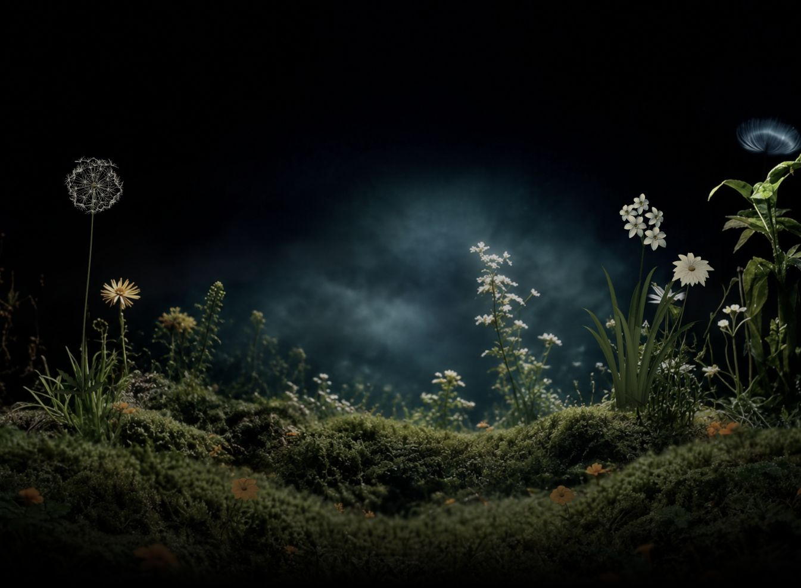

# MIIOO 夜间花园首页交接

> **2026-10-28 新版提示：** 默认入口现已改为用户确认的“保留 MIIOO 品牌、复刻 Neuralyn 参考视觉”的首页，包含摄影感交互背景、标题与示例工作台。新版说明见 [REDESIGN.md](REDESIGN.md)，旧入口保存在 [garden-original.html](garden-original.html)。以下全文保留为此前三维花园交接记录；其中“当前版本”“待实现”等描述属于历史状态，不能替代新版源码和验收记录。

交接日期：2026-10-28。本文描述当前版本；README.md 包含多轮历史记录，发生冲突时以当前源码和本文为准。

## 最高优先级：性能优先（用户最新强调）

性能是后续工作的首要约束，优先于增加几何细节、实时阴影和交互复杂度。文中六项视觉要求仍然有效，但实现方式必须服从普通桌面电脑的运行成本，不能将“所有植物可交互”等同于“所有植物都建立高精度三维模型”。

执行顺序调整为：先保存当前版本并测量性能基线 → 优化现有更新与绘制成本 → 选定分层画质和预算 → 分批实现视觉与交互需求，每批进行回归测量 → 最后整体验收。下文 P0/P1 是内容清单，不得据此跳过性能工作。

- 测试至少覆盖一台普通集成显卡办公电脑和一台主流电脑；记录 CPU/GPU、浏览器、窗口尺寸、像素比与画质设置。没有设备覆盖时明确标记未验证，不能以开发机表现代替结论。
- 建议验收目标：主流电脑接近稳定 60 FPS，较弱设备经自动降级后稳定 30 FPS；这是待测目标，不是当前保证。记录帧耗时中位数、P95、明显卡顿、draw call、三角形数、加载时间和内存趋势；分别测试常态风、快速扫过、窗口缩放与长时间运行。
- 优先消除每帧逐顶点角度写入及上传，合批独立花瓣，评估实例化、简化微小几何；先保留可见效果，再决定是否降低画质。
- 近景保留可辨识的三维细节；中远景优先采用低成本分层网格、实例化或简化变形。新增黄花/粉花共享几何与材质；常态风使用共享风场和个体参数，不为所有植物叠加昂贵独立求解。
- 实时阴影、像素比、后处理模糊均应有明确预算和降级路径。根据持续帧耗时选择档位，设置观察窗口和恢复滞后，避免画质频繁跳动。
- 保留静态回退与减少动态效果支持。正常交互时不做几何重建、大量临时分配或网络请求。
- 新增任何视觉功能前后，在同一设备、同一画幅和同一交互条件下对比；若超出预算，先简化实现或降低该效果成本，不继续堆叠功能。

当前尚未完成正式性能测试、自动降级或跨设备验收。模型导出通过、控制台无错误和顶点数下降均不能代替流畅度证明。

## 最新补充：六项待实现要求（优先于此前方向描述）

以下为用户最新明确要求，尚未在画面或源码中实现。本轮仅更新交接文档。源码记录当前状态，不能用当前状态替代目标要求。

| 项目 | 用户要求 | 实施与验收要点 |
| --- | --- | --- |
| 常态风 | 当前微风不满意；风应更大，随时间有强有弱 | 提升可见摆幅，加入平滑变化的风速包络、间歇阵风与缓和期，避免固定节拍。现有正弦变化仍未达到用户期望；不要标记为风效已验收。连续观察应感到风在增强、减弱，不能靠高频抖动替代风感。 |
| 交互覆盖 | 除苔藓外，其他植物都应可交互；近景清晰植物幅度大、远景幅度小 | 不再只覆盖五株主要植物。逐项盘点背景照片中的草、枝叶、花，建立可交互层或几何与深度权重；新增黄花和粉花也纳入。根部保持固定，鼠标扫过各区域均有相应反馈；苔藓保持静态。 |
| 苔藓小花 | 增加苔藓中的小黄花，也可以增加同类型粉色小花 | 黄色数量增加为明确要求，粉色为允许补充的方向；保持小花的同类形态与自然疏密，避免均匀撒点。与大花“减少密度、单朵清楚”的要求分别处理。 |
| 画幅 | 16:9 | 以固定 16:9 构图设计并验收，如 1920×1080。当前背景基准 1536×1024 是 3:2，随窗口 cover 的现状不满足此要求。需重排或裁切并同步植物位置、相机与指针映射；非 16:9 桌面窗口建议留黑边保持画幅，此为实施建议。 |
| 明暗与色彩 | 中间的苔藓更亮，整体饱和度再上调 5% | 提亮的是中央地面苔藓，不是中央雾。保留底部/两角暗部与中央空间。当前 saturate(.82)；建议先按相对提高 5% 试配至 .861，并记录数值；如果指加 5 个百分点则为 .87，二者不要混写为同一要求。最终以视觉确认为准。 |
| 右上角异物 | 去掉飞起的、像水母又像蒲公英的白色物体 | 定位背景及静态回退里的对应区域，移除并补齐周边暗背景，避免矩形补丁、残影或影响相邻叶片；各加载状态都不应再次出现。 |

这些要求会扩大交互覆盖，特别是摄影背景中的植物不能通过调整现有五株风参数自动获得交互。需要先做植物区域与深度拆分，再选择分层变形或三维重建，结合性能预算实施。

## 1. 目标与当前阶段

最终用于替换 https://miiooai.com/ 的首页视觉。目标是一幅接近真实摄影质感的暗色花园：黑色背景、绿色植物、清晰可辨的白花和少量橙花，中央留白并略有光照，薄雾有层次且缓慢向两侧扩散，底部与左右下角柔和融入黑色。

交互应像一阵真实的风：常态有微风；鼠标经过时带起局部强风；花茎、花瓣、冠毛、长叶有不同响应速度，风过后明显回弹并迅速收稳。不要卡通、果冻、整株同步摇动或持续被鼠标压住的感觉。

当前是可运行的视觉与交互原型，尚未接入真实网站业务或部署。实现方式是摄影背景加局部三维植物，并非整个花园的三维重建。摄影级真实感仍是目标，不能把当前程序化模型视为已达到摄影扫描质量。

## 2. 用户已经明确的方向

- 只考虑桌面，暂不需要手机适配。
- 保留常态风和鼠标经过阵风；已取消按住拖动交互。常态风目前不满意，必须增强并加入明显的时间强弱变化。
- 花朵不要过小、过密，要能辨认单朵结构，并有自然间隙。
- 花枝要有粗细渐变、弧度、体积与连接组织，不能像细线。
- 原右侧伞形白花已按水仙参考替换为五朵六瓣白花，黄色杯状花心；细长叶丛也是参考的重要部分。
- 不要只处理花，整株的茎、叶、根部融合都要同步考虑。
- 最后试加的标题、副标题、磨砂玻璃框、角落署名已全部按用户要求移除。当前交付是纯花园；不要擅自恢复这些元素。真实首页文案与导航另行确认。
- 雏菊较快的阵风回弹曾获用户明确认可，后续修改应保留这一感觉。其他植物多轮调整属于迭代状态，不代表整体最终验收。

## 3. 当前画面



此图是移除文字和玻璃框后的截图。不同桌面窗口比例会影响裁切；动画截帧位置也会不同。preview-glass-hero.png 和早期伞形白花截图仅供历史对照。

## 4. 已完成

| 模块 | 当前实现 |
| --- | --- |
| 背景与构图 | 本地摄影背景、正交相机、覆盖式缩放、底部对齐；CSS 黑色底部及下角渐变；饱和度 .82 |
| 氛围 | 中央轻微提亮、压低原图烘焙雾亮度，再叠加多尺度噪声薄雾；原照片的雾仍存在 |
| 左侧蒲公英 | 64 簇冠毛，每簇 10 根细毛；独立簇偏转、末端颤动、花茎回摆；不含种子脱落 |
| 右侧雏菊 | 两圈共 24 片独立花瓣，固定瓣根、局部弧形弯曲、较快阵风衰减和回弹 |
| 水仙花簇 | 五朵大小错落的六瓣白花，30 片独立花瓣，黄色开放杯状花心、暗色喉部、五个受风花梗 |
| 水仙叶丛 | 九片独立长带状叶；浅槽、厚度、扭转、纵向纹理、叶尖下弯；根部固定，中上段弯曲，叶尖延迟；增加六片根部短叶 |
| 茎与连接 | 粗细渐变、微弯、近椭圆截面；水仙花梗具有厚度；根部颜色过渡与局部遮挡 |
| 前景橙花 | 两株完整程序化几何与整株风响应；尚未按水仙/雏菊标准精修独立花瓣 |
| 材质与光照 | 程序化色素、凹凸和粗糙度图，薄组织背光散射近似；暖主光、冷背光、弱补光 |
| 阴影 | 水仙使用 2048 PCFSoft 局部自阴影；深度材质同步风形变，其他植物未开启同样的投射/接收 |
| 基础兼容 | 减少动态效果设置、失焦及隐藏页重置、初始化异常静态图回退 |

物理均为弹簧阻尼及几何弯曲近似，没有空气流体求解、植物碰撞、严格不可伸长叶片或完整体积次表面散射。

## 5. 项目入口与运行

项目目录：/Users/haoliangyin/Documents/Codex/2026-10-27/ni/outputs/interactive-garden

当前预览：http://127.0.0.1:8766/

如端口已有服务，直接访问；不要重复启动。换电脑后，在项目目录执行：

```sh
python3 -m http.server 8766 --bind 127.0.0.1
```

用 HTTP 服务打开，不能直接双击 index.html；模块和 fetch 需要服务器。运行时使用本地 Three.js 和图片，不需要 API key、第三方中转平台或联网生成图片。

| 文件 | 用途 |
| --- | --- |
| index.html | 页面、图片回退、饱和度及暗角；当前没有标题或玻璃框 |
| garden-3d.js | 当前主入口；相机、灯光、阴影、指针阵风、固定步长模拟、可见与深度着色器 |
| plant-models.js | 五株植物的程序化几何、花瓣/冠毛/叶片参数 |
| botanical-materials.js | 本地生成材质纹理、背光散射；strap 为水仙长叶的纵向纹理 |
| atmosphere.js | 动态薄雾 |
| assets/plants.json | 植物位置、半径、刚度；坐标以 1536×1024 背景为基准 |
| assets/garden-background-v2.png | 当前三维场景的摄影背景 |
| assets/garden-clean-v1.png | 初始化前及失败时的静态图片，仍为旧植物外观，需更新 |
| models/*.three.json | 静态模型导出；页面实际运行时直接调用 createPlant，不读取这些文件 |
| vendor/ | 本地 Three.js 及许可证 |
| README.md | 历史实现日志，不是统一的最终规格 |
| garden-layered.js、garden.js | 历史版本，当前入口没有使用 |

仓库工作目录 work/export-plants.mjs 可通过 node work/export-plants.mjs 检查并更新模型。它检查有限顶点、三维范围和表面 UV；不代替浏览器着色器及动态验证。

## 6. 接手时特别注意

1. 内部名称 white-umbel 现在实际是水仙。模型、布局、阴影和交互仍使用这个名字；如重命名需要一起修改，不能仅改显示名。
2. 局部花瓣变形必须先于花梗、整株变形；法线与阴影采用一致顺序。长叶使用独立根部弯曲，覆盖整株茎变形。
3. 不同着色器分支必须有不同 customProgramCacheKey，包括独立花瓣、冠毛、长叶和深度材质。此前曾出现程序缓存复用导致花瓣不动的问题。
4. 当前固定模拟步长为 1/120 秒。修改刚度、阻尼需同时检查响应速度和反向回摆，避免变成缓慢压下后恢复。
5. 水仙长叶的局部鼠标采样覆盖叶片中段；需在不同窗口下检查实际可触发区域。
6. 根部“融入苔藓”目前依赖错位、短叶和暗部过渡，没有真实三维苔藓遮挡所有连接。

## 7. 性能现状与待办

当前导出统计：蒲公英 16878、水仙 77604、雏菊 61242、左橙花 30810、右橙花 30810，共 217344 顶点。几何组共 96 个，其中水仙 46 个；组数不等于实际每帧 draw call，阴影还会增加通道。

渲染像素比上限 1.75；水仙局部阴影贴图 2048。水仙分枝角度与蒲公英冠毛角度仍有逐顶点属性写入和上传。拆分独立花瓣虽未增加顶点总量，但增加绘制调用。

没有正式 FPS、GPU 帧耗时、内存或跨设备测试，不能承诺普通办公电脑稳定 60 FPS。没有动态画质降级，也没有完整 context loss 恢复方案。

建议下一轮性能工作：先记录基线；将分枝/冠毛角度改为少量 uniform 或数据纹理传入；评估花瓣合批和几何简化；再考虑自动像素比和阴影等级。优化前后截图对照，避免直接牺牲目前画面。

## 8. 剩余工作与建议顺序

### P0：确认当前视觉基准

- 优先落实文首六项新要求：16:9 构图、异物清除、中央苔藓亮度与饱和度、小黄花补充、常态风升级和全植物交互覆盖。不得把当前截图当成最终批准稿。

- 与用户确认水仙花簇大小、叶丛比例、绿色亮度是否满意；目前仍能看出程序化建模感。
- 检查冠毛是否过于线框化、叶片是否过于整齐或像硬带；避免用增加密度掩盖形态问题。
- 确认中央雾的浓度和层次；照片中已有的固定雾限制了纯动态调整。
- 先保存当前可运行版本，再开展下一轮改动。

### P1：补全植物与性能基线

- 精修两朵前景橙花的姿态、瓣片、花茎及局部风响应。
- 水仙继续优化花心厚度、叶片正反面、柔和反光与根部融合，保持少而清楚的花型。
- 测量并优化性能，尤其独立花瓣绘制调用与逐顶点角度更新。
- 以 16:9 验收构图，并检查其他桌面窗口能否保持该画幅；当前 cover 会裁掉侧边植物，需修改。

### P2：正式首页与发布

- 与用户确认最终品牌文案、导航、主要入口及首页功能。先前玻璃框样稿已撤回，不应当作已确认 UI。
- 接入真实网站工程；现阶段没有网站路由、内容管理、业务逻辑或部署集成。
- 更新静态回退图片到当前水仙版本，避免加载时闪回旧植物。
- 完成加载性能、图片体积、浏览器兼容、减少动态效果、键盘/阅读顺序等上线检查。
- 检查照片及其他素材的最终使用授权，保留 Three.js 许可证；部署目标和流程尚未确定。

## 9. 验收方法

- 常态连续观察：风比当前明显增强，随时间有强弱和缓和期；花、叶响应有差异，根部不滑移；雾不遮没植物。
- 鼠标横向扫过：覆盖除苔藓外的全部植物，包括背景草叶和新增小花；近景清晰植物幅度大、远景小；移开后回摆收稳，无拖拽依赖。
- 16:9 画面中中央苔藓更亮，整体饱和度略升，小黄花数量增加；右上角白色漂浮异物在动态画面及静态回退中均消失。
- 视觉检查：花瓣不脱离花心、叶根不漂浮、花茎不拉长成果冻、阴影不留在原位。
- 改窗口、失焦返回、减少动态效果分别验证；初始化失败应可看到静态回退。
- 浏览器无着色器错误；模型修改后运行导出检查；另行记录 FPS、帧耗时及测试设备，不能只凭控制台无错误判定流畅。

已做：当前版本的浏览器加载、花头与叶丛指针扫过、模型导出检查。中间曾有自动审批服务 503 导致检查未执行，后续已补做叶丛与花头扫过；不要将历史日志中的中断当作仍然阻塞。

## 10. 给接手同事的一句话

请在现有纯花园版本上继续，目标是“16:9 摄影感暗色花园 + 更明显且随时间强弱变化的自然风 + 除苔藓外全植物分远近交互”。以文首六项新增要求修订构图、氛围和覆盖范围，再把真实感与运行成本做好，最后接入正式首页内容。
