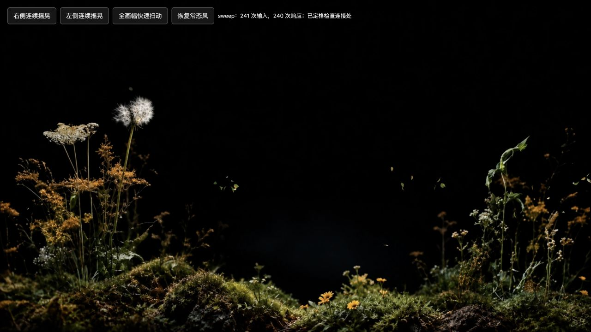

# 鼠标摇晃接缝修复

2026-10-29，桌面 Web。版本标识：`20261029-continuous-r3`。

## 原因与修复

旧渲染把摄影植被拆成 5 个主体裁片和 6 个细节裁片。主体各自弯曲，细节从主体挖出的矩形孔中独立转动；强风下边缘位移不同，尤其右侧叶片跨主体分界时出现裂缝。这不是单靠帧率优化能消除的问题。

现在使用一张 144×80 连续索引网格，纹理和 alpha 只绘制一次。5 组风响应按横向位置连续混合，6 处局部花叶形变在四边及连接处归零，根部在进入地面混合区前固定。无矩形切片或矩形孔洞。相邻风场差值软限为 0.16 弧度且保留平均风向；局部角度最终软限为 0.14 弧度，叶片扭转平滑。

鼠标冲量按真实时间积分，避免高刷新率下不断叠加出过强阵风。两个入口及复验页使用版本化模块 URL，避免继续显示旧缓存。

## 验证

- JavaScript 语法检查通过。
- `motion-continuity-checks.html` 分别复现左侧、右侧和全画幅快速往返，检查花头、叶柄、主体交界和根部。未再观察到旧的矩形接缝。
- 最终 r3 全画幅 4 秒测试：241 次输入、240 次响应，1280×720，DPR 1.50，约 60 FPS；帧间隔中位 16.70ms、P95 17.50ms。5 次绘制调用，36 片活跃飘叶时 29,092 个三角形。更密的连续网格增加了顶点预算，但取消了十个独立植被绘制。
- 连续网格版本通过减少动态效果默认暂停、WebGL 不可用静态回退及上下文 ready → fallback → ready 恢复。常规摇晃测试没有着色器错误或警告。
- 数值压力检查覆盖 4 种相邻 ±0.32 弧度主体弯曲组合，以及局部 ±0.14 弧度、0.24 弧度扭转；全画面 80×80 加六个局部 40×40 的有限差分采样中，二维映射 Jacobian 全为正，最小约 0.1174。此采样用于排查翻折，不是任意参数下的数学证明。

测试使用本机 Codex 内置浏览器（MacBook Air / M4 / macOS 27.2）；帧间隔不是 GPU 独立耗时，未进行跨设备验收。

